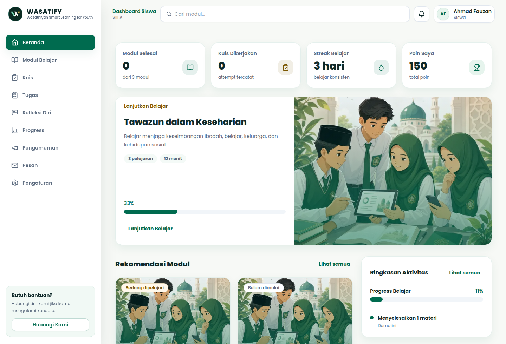
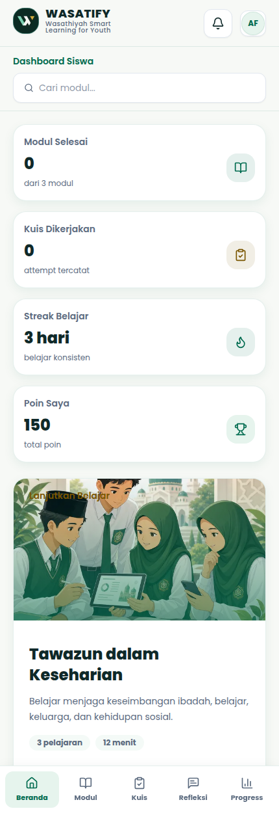

# WASATIFY

**Wasathiyah Smart Learning for Youth**

WASATIFY adalah aplikasi microlearning Islam Wasathiyah untuk siswa dan guru. Siswa mempelajari modul, mengerjakan kuis dan tugas, menulis refleksi, serta memantau progres. Guru mengelola kelas, materi, penilaian, dan laporan.

## Dashboard

Tangkapan layar memakai data demo.

### Desktop



### Mobile



## Fitur

| Peran | Fitur |
| --- | --- |
| Siswa | Modul dan materi, kuis dan pembahasan, tugas, refleksi, progres dan pencapaian, pengumuman, pesan |
| Guru | Kelas dan pendaftaran siswa, editor modul, kuis, tugas dan penilaian, media, refleksi, laporan, pengumuman, pesan |
| Admin | Kode undangan guru |
| Demo | Workspace siswa dan guru dengan data yang terpisah dari akun produksi |

## Teknologi

- Next.js 16 App Router dan TypeScript
- React 18, Tailwind CSS, shadcn/ui, lucide-react
- Supabase Auth, PostgreSQL, dan Storage
- Vercel

Versi dependensi tercatat di `package.json` dan `package-lock.json`. Next.js memerlukan Node.js 20.9 atau lebih baru.

## Menjalankan lokal

```bash
cp .env.example .env.local
npm ci
```

Isi konfigurasi berikut di `.env.local`:

| Variabel | Penggunaan |
| --- | --- |
| `NEXT_PUBLIC_SUPABASE_URL` | URL proyek Supabase |
| `NEXT_PUBLIC_SUPABASE_ANON_KEY` | Koneksi Supabase dari browser dan server |
| `NEXT_PUBLIC_SITE_URL` | Origin aplikasi untuk callback autentikasi; gunakan `http://localhost:3100` saat lokal |
| `SUPABASE_SERVICE_ROLE_KEY` | Operasi server pada alur reset password |

`SUPABASE_SERVICE_ROLE_KEY` hanya dibaca di server. Kredensial Google OAuth dikonfigurasi pada Supabase Auth.

Jalankan server pengembangan:

```bash
npm run dev -- --port 3100
```

Buka `http://localhost:3100`. Workspace demo tersedia di `/demo`, `/demo/students`, dan `/demo/teacher`.

Untuk menjalankan build produksi lokal:

```bash
npm run build
npm run start -- --port 3100
```

## Supabase

Atur Site URL dan Redirect URLs Supabase Auth agar sesuai dengan origin aplikasi. Callback Google menggunakan URI proyek Supabase dengan path `/auth/v1/callback`. Callback aplikasi memvalidasi origin melalui `src/app/auth/callback/route.ts`.

`supabase/schema.sql`, `supabase/rls.sql`, dan `supabase/storage.sql` adalah snapshot struktur. Perubahan berikutnya dicatat di `supabase/migrations/`. Untuk proyek yang sudah terhubung, periksa status sebelum menerapkan migrasi:

```bash
npx supabase link --project-ref <project-ref>
npx supabase migration list
npx supabase db push --dry-run
npx supabase db push
```

Snapshot tersebut bukan baseline lengkap untuk membangun database kosong. Periksa dependensi migrasi sebelum menyiapkan proyek baru.

Siswa menyimpan progres belajar melalui RPC transaksional `complete_learning_lesson`, `submit_learning_quiz`, `submit_learning_reflection`, dan `claim_learning_achievements`. Penyimpanan atau duplikasi modul guru memakai `save_teacher_module`. Nilai kuis dinormalisasi hingga maksimal 100 poin.

## Struktur kode

```text
src/app/                  Route, halaman server, layout, dan API
src/components/           Komponen bersama, siswa, guru, auth, admin, dan demo
src/lib/                  Logika domain, autentikasi, media, dan Supabase
src/hooks/                Hook bersama
supabase/migrations/      Perubahan database berversi
tests/                    Regresi kode dan database
docs/                     Catatan audit dan dokumentasi teknis
```

Demo menggunakan penyimpanan browser dan tidak membuat rekaman belajar pada akun produksi. Antrean komentar pengembang juga bersifat lokal: widget development menyimpan komentar ke `db/feedback.json`; API feedback tidak tersedia di build produksi.

## Pemeriksaan

```bash
npm run lint
npm run build
node --test tests/audit-regression.test.mjs
```

Skrip regresi database tersedia di `tests/student-database-regression.sql`, `tests/teacher-database-regression.sql`, dan `tests/assignment-regression.sql`. Skrip memakai transaksi yang diakhiri `ROLLBACK` dan memerlukan akun fixture yang sesuai.

## Deploy

Sebelum deploy, terapkan migrasi pada proyek Supabase tujuan. Konfigurasikan variabel pada tabel di atas, lalu selaraskan `NEXT_PUBLIC_SITE_URL`, Supabase Site URL, Redirect URLs, dan domain deployment. Deploy Next.js melalui Vercel dengan perintah build `npm run build`.

`AGENTS.md` berisi peta proyek dan aturan kontribusi. [Catatan audit](docs/audit-2026-10-29.md) memuat bukti pemeriksaan dan batas verifikasi per 30 Oktober 2026.
